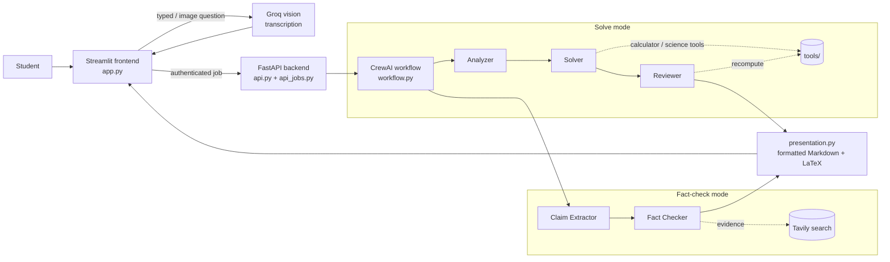

# Agentic JEE Assistant

A multi-agent tutor for **JEE Mathematics, Physics and Chemistry**. Separate CrewAI agents analyze a question, solve it step by step and review the solution. The app also has an **educational fact-checking** mode, which splits a statement into claims and checks each one against retrieved evidence. Questions can be typed or uploaded as an image.

## Features

- **Three-agent solving pipeline.** The *Analyzer* classifies the subject, topic and question type and states any assumptions. The *Solver* writes a step-by-step solution. An independent *Reviewer* recomputes the key steps. A rejected solution gets one correction and a fresh review.
- **Tool-grounded maths.** The solver and reviewer call a bounded calculator and science tools instead of doing the arithmetic in the LLM.
- **Image questions.** A Groq vision model transcribes a JPG, PNG or WebP screenshot, including the equations, options and diagram labels. The student reviews the text before it is solved.
- **Educational fact-checking.** A *Claim Extractor* agent and a *Fact Checker* agent evaluate up to five claims against evidence retrieved through Tavily. Without evidence, the verdict is *inconclusive* rather than a guess.
- **Readable output.** Rendered LaTeX equations, the answer shown first, and the assumptions listed explicitly.
- **Production-minded backend.** An authenticated FastAPI job queue with idempotent submission, polling and resume, per-job timeouts in isolated processes, rate-limit handling and bounded retries.

## Architecture



If `JEE_API_URL` is not set, the Streamlit app runs the same workflow in-process, which keeps local development simple.

## Tech stack

Python 3.12 · CrewAI · Groq (`gpt-oss-120b` and a vision model) · Streamlit · FastAPI · Pydantic · Tavily · uv · Render

## Quick start

```bash
git clone https://github.com/BalaMSD7781/agentic-jee-assistant.git
cd agentic-jee-assistant
uv sync --locked --no-dev            # creates .venv with pinned dependencies
cp .env.example .env                 # add your GROQ_API_KEY (TAVILY_API_KEY is optional)
uv run streamlit run app.py
```

Try `Solve 2x + 5 = 15`. Or upload a question screenshot, click **Extract question from image**, check the text, then click **Run / retry**.

Command-line use:

```bash
uv run python run_flow.py "A body moves in a circle of radius 0.5 m at 4 rad/s. Find its centripetal acceleration."
uv run python run_flow.py --mode fact_check "Water boils at 100 °C at every altitude."
```

On Windows, `START_LOCAL.cmd` starts the app on a free port and opens the browser.

## Configuration

All settings are environment variables. See [`.env.example`](.env.example) for the full list and their allowed ranges.

| Variable | Purpose |
|---|---|
| `GROQ_API_KEY` | LLM and vision provider key (required) |
| `JEE_MODEL` / `JEE_VISION_MODEL` | Model for the reasoning agents and model for image transcription |
| `TAVILY_API_KEY` | Evidence search for fact-checking (optional) |
| `JEE_API_URL` / `JEE_API_TOKEN` | Split frontend/backend hosting with a shared secret |
| `JEE_HISTORY_MODE` | `session` (safe on shared hosts) or `local` (single-user SQLite history) |

## Deployment

[`render.yaml`](render.yaml) defines two Render services: the API backend (`api_server.py`, health check `/health`) and an optional Streamlit frontend (`frontend_server.py`). The frontend can also run on Streamlit Community Cloud, using [`.streamlit/secrets.toml.example`](.streamlit/secrets.toml.example) as the template. Only the backend needs the Groq key.

Step-by-step instructions are in [`experiments/deployment/DEPLOYMENT.md`](experiments/deployment/DEPLOYMENT.md).

**API:** `GET /health`, and with authentication `POST /api/v1/jobs`, `GET /api/v1/jobs/{id}` and `GET /api/v1/queue`. Interactive docs are served at `/docs`.

## Tests and benchmarks

```bash
uv run python -m unittest discover -s experiments/tests -v
uv run python experiments/benchmarks/run_benchmark.py          # deterministic; add --live to call the provider
```

The unit tests mock every external API, so they need no credentials.

## Project structure

```
app.py                  Streamlit interface
run_flow.py             Command-line interface
api_server.py           Backend entrypoint (FastAPI via uvicorn)
frontend_server.py      Streamlit entrypoint for Render
src/agentic_jee_system/
  workflow.py           Routing, reasoning stages, review and correction loop
  backend.py            CrewAI agents, model settings, request pacing
  vision.py             Image question transcription
  evidence.py           Evidence retrieval for fact-checking
  tools/                Calculator, science helpers, structured outputs
  api*.py               HTTP API, job queue, client and contracts
  presentation.py       Student-facing Markdown/LaTeX formatting
  reliability.py        Retries and error handling
experiments/            Tests, benchmarks, deployment guides, validation reports, legacy CrewAI flow
```

## Limitations

The review step is a second opinion, not a guarantee of correctness. Answers are marked *completed* rather than *verified*. Provider quotas and network availability affect every request.
